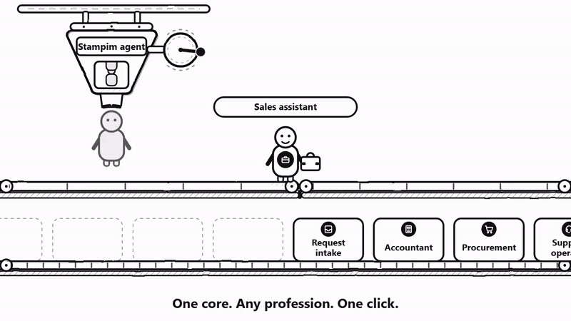

**English** · [Русский](README.ru.md)

# stampim-agent

**Digital employees inside your corporate system — not a chatbot on the side.**

We embed AI agents into existing corporate systems, applications and websites.
No rewrite of your system and no separate portal: the agent shows up where people
already work.

Website: https://stampim.su/
Contact: https://t.me/agent_team_ai

## As many agents as you need

One agent or dozens — it is one integration. All agents share one core; a new agent
is a new configuration and a set of skills, not a new development project. You do
not need a dedicated developer per agent.

## How we embed

**Embed with a single script tag.** One line is added to your page, and the agent
panel appears over your interface. No UI to build. On top of it comes our display
layer: highlighting the right object on screen, cards, dashboards, voice input.

**Embedding demo.** [Video, 30 s](demo/stampim-agent-demo.mp4) · [GIF](demo/stampim-agent-demo.gif)

**Seamless sign-in.** The agent has no privileges of its own in your system. When
embedded with a script tag, the panel runs in the employee's browser: it reads the
visible page and, if your API is connected, calls it from the same browser on
behalf of that employee. The agent sees exactly what the person who opened it
sees, and cannot do more. The employee's credentials — their session — are
neither sent to us nor stored by us: we get no separate access to your system.

**Data access grows on demand.** Screen → your API → our skills. Each step is
connected separately, when it is actually needed, not upfront. Start with what is
visible on the page; need more — connect your API; need a calculation — call our
skill.

**Background work runs on a separate channel.** Scheduled digests, sweeps and
reminders live on the server and do not need an open browser tab.

## Independent benchmarks

We test the agent on the open tau2 benchmarks (retail, airline, telecom) using the
open Exgentic harness — the same one used by the Open Agent Leaderboard. In these
runs our agent is called **stampim-agent**.

**In short:** on retail, a score of 0.789 — within the range of the Claude Opus
rows in the public table (0.78–0.85, at the lower end), at a per-task cost 78–266
times lower. On the same model it is on par with the harness's baseline agent, and
on retail it costs half as much.

Conditions: one attempt per task; deepseek-flash for both the agent and the user
simulator; score by database state after the dialogue (the NL judge was not
called); runs were done locally and have not yet been submitted to the public
leaderboard.

| Benchmark | Agent | Score | Tasks | Steps per task | Agent cost per task | Total cost per task |
|---|---|---:|---:|---:|---:|---:|
| tau2 retail | **stampim-agent** | **0.789** | 114 | 13.08 | $0.0060 | $0.0064 |
| tau2 retail | tool_calling, same model | 0.798 | 114 | 10.25 | $0.0113 | $0.0117 |
| tau2 airline | **stampim-agent** | **0.560** | 50 | 13.90 | $0.0112 | $0.0117 |
| tau2 airline | tool_calling, same model | 0.560 | 50 | 9.34 | $0.0109 | $0.0113 |
| tau2 telecom | **stampim-agent** | **0.789** | 114 | 16.85 | $0.0068 | $0.0085 |
| tau2 telecom | tool_calling, same model | 0.825 | 114 | 15.43 | $0.0209 | $0.0227 |

"Total cost" includes the user simulator; "agent cost" is the agent's work only.

On tau2 retail stampim-agent scores **0.789 vs 0.798** for tool_calling on the same
model and costs **1.9 times less** per task on the agent: $0.0060 vs $0.0113. On
airline the score is equal — **0.560 for both** — and the cost is nearly equal:
$0.0112 vs $0.0109. The retail cost advantage does not carry over to airline, and
we show it as it is. On telecom stampim-agent scores **0.789 vs 0.825** (4 tasks out
of 114 in a single attempt — within run-to-run noise) and costs **3.1 times less**
on the agent: $0.0068 vs $0.0209.

### For reference — the public table

Cost in the public table is the agent's cost without the simulator; we compare on
the same column.

| Benchmark | Agent | Model | Score | Steps per task | Agent cost per task |
|---|---|---|---:|---:|---:|
| tau2 retail | openai_solo | claude-opus-4-5 | 0.85 | 12.54 | $0.550 |
| tau2 retail | claude_code | claude-opus-4-5 | 0.83 | 12.54 | $1.599 |
| tau2 retail | tool_calling | DeepSeek-V3.2 | 0.82 | 14.44 | $0.0296 |
| tau2 retail | smolagents_code | claude-opus-4-5 | 0.78 | 11.71 | $0.671 |
| tau2 retail | tool_calling | claude-opus-4-5 | 0.78 | 11.33 | $0.467 |
| tau2 retail | claude_code | DeepSeek-V3.2 | 0.65 | 12.51 | $0.0436 |
| tau2 airline | tool_calling | DeepSeek-V3.2 | 0.56 | 15.28 | $0.0340 |
| tau2 telecom | smolagents_code | gemini-3-pro-preview | 0.88 | 12.71 | $0.346 |
| tau2 telecom | tool_calling | DeepSeek-V3.2 | 0.71 | 18.11 | $0.0494 |

The Claude Opus rows score 0.78–0.85 at $0.47–1.60 per task. stampim-agent at 0.789
costs $0.0060 — **78–266 times less**; against claude_code on Claude Opus the gap
is **266 times**.

The core is closed-source.

License: Apache-2.0.
