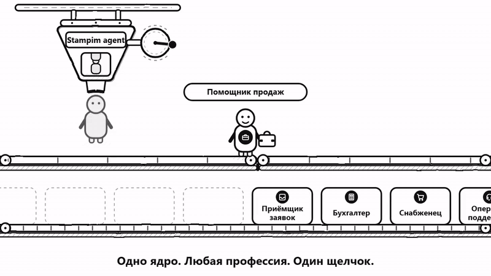

[English](README.md) · **Русский**

# stampim-agent

**Цифровые сотрудники внутри вашей корпоративной системы — не чат-бот сбоку.**

Внедряем ИИ-агентов в действующие корпоративные системы, приложения и сайты.
Без переписывания системы, без отдельного кабинета: агент появляется там, где уже
работают люди.

Сайт: https://stampim.su/
Связаться: https://t.me/agent_team_ai

## Агентов — столько, сколько нужно

Один агент или десятки — это одно внедрение. Ядро у агентов общее, а новый агент —
это новая конфигурация и набор навыков, а не новый проект разработки: отдельного
программиста под каждого агента не нужно.

## Как мы встраиваемся

**Встраивание одной строкой.** В вашу страницу добавляется одна строка — и панель
агента появляется поверх вашего интерфейса. Писать интерфейс не нужно. Поверх —
наш слой показа: подсветка нужного объекта на экране, карточки, дашборд,
голосовой ввод.

**Бесшовный вход.** У агента нет собственных прав в вашей системе. При
встраивании строкой панель работает в браузере сотрудника: читает видимую
страницу, а если подключён ваш API — обращается к нему из того же браузера от
имени этого сотрудника. Агент видит ровно то, что видит открывший его человек, и
не может больше. Учётные данные сотрудника — его сессия — при этом нам
не передаются и у нас не хранятся: отдельного доступа к вашей системе мы не
получаем.

**Данные наращиваются по факту.** Экран → ваш API → наши навыки. Каждый шаг
подключается отдельно, когда он действительно нужен, а не авансом. Начали с того,
что видно на странице; понадобилось больше — подключили ваш API; понадобился
расчёт — вызвали наш навык.

**Фоновая работа — отдельным каналом.** Сводки по расписанию, обходы,
напоминания живут на сервере и не требуют открытой вкладки.

## Независимые замеры

Проверяем агента на открытых бенчмарках tau2 (retail, airline, telecom) через
открытый стенд Exgentic — тот же, что используется в Open Agent Leaderboard. Наш
агент в замерах называется **stampim-agent**.

**Коротко:** на retail счёт 0,789 — в диапазоне строк Claude Opus из публичной
таблицы (0,78–0,85, у нижней границы), при цене задачи в 78–266 раз меньше. На той же модели — вровень с
базовым агентом стенда, на retail вдвое дешевле.

Условия: одна попытка на задачу; модель deepseek-flash у агента и у симулятора;
счёт — по состоянию базы после диалога (NL-судья не вызывался); прогоны сделаны
у себя и пока не поданы в публичную таблицу.

| Бенчмарк | Агент | Счёт | Задач | Шагов на задачу | Цена агента за задачу | Полная цена за задачу |
|---|---|---:|---:|---:|---:|---:|
| tau2 retail | **stampim-agent** | **0,789** | 114 | 13,08 | $0,0060 / 0,52 ₽ | $0,0064 / 0,56 ₽ |
| tau2 retail | tool_calling, та же модель | 0,798 | 114 | 10,25 | $0,0113 / 0,98 ₽ | $0,0117 / 1,01 ₽ |
| tau2 airline | **stampim-agent** | **0,560** | 50 | 13,90 | $0,0112 / 0,97 ₽ | $0,0117 / 1,01 ₽ |
| tau2 airline | tool_calling, та же модель | 0,560 | 50 | 9,34 | $0,0109 / 0,94 ₽ | $0,0113 / 0,98 ₽ |
| tau2 telecom | **stampim-agent** | **0,789** | 114 | 16,85 | $0,0068 / 0,59 ₽ | $0,0085 / 0,74 ₽ |
| tau2 telecom | tool_calling, та же модель | 0,825 | 114 | 15,43 | $0,0209 / 1,81 ₽ | $0,0227 / 1,96 ₽ |

Цена — в долларах и рублях по курсу 86,47 ₽/$ (тот же курс используется в учёте
продукта). «Полная цена» включает симулятора пользователя, «цена агента» — только
работу агента.

На tau2 retail stampim-agent набирает **0,789 против 0,798** у tool_calling на той
же модели и стоит **в 1,9 раза дешевле** на агенте: $0,0060 против $0,0113 за
задачу. На airline счёт равный — **0,560 у обоих**, — и цена почти равна:
$0,0112 против $0,0109. Преимущество retail на airline не переносится, и мы
показываем это как есть. На telecom stampim-agent набирает **0,789 против 0,825**
(4 задачи из 114 при одной попытке — в пределах разброса между прогонами) и стоит
**в 3,1 раза дешевле** на агенте: $0,0068 против $0,0209.

### Для ориентира — публичная таблица

Цена в публичной таблице — стоимость агента без симулятора; сравниваем по той же
колонке.

| Бенчмарк | Агент | Модель | Счёт | Шагов на задачу | Цена агента за задачу |
|---|---|---|---:|---:|---:|
| tau2 retail | openai_solo | claude-opus-4-5 | 0,85 | 12,54 | $0,550 |
| tau2 retail | claude_code | claude-opus-4-5 | 0,83 | 12,54 | $1,599 |
| tau2 retail | tool_calling | DeepSeek-V3.2 | 0,82 | 14,44 | $0,0296 |
| tau2 retail | smolagents_code | claude-opus-4-5 | 0,78 | 11,71 | $0,671 |
| tau2 retail | tool_calling | claude-opus-4-5 | 0,78 | 11,33 | $0,467 |
| tau2 retail | claude_code | DeepSeek-V3.2 | 0,65 | 12,51 | $0,0436 |
| tau2 airline | tool_calling | DeepSeek-V3.2 | 0,56 | 15,28 | $0,0340 |
| tau2 telecom | smolagents_code | gemini-3-pro-preview | 0,88 | 12,71 | $0,346 |
| tau2 telecom | tool_calling | DeepSeek-V3.2 | 0,71 | 18,11 | $0,0494 |

Строки на Claude Opus дают счёт 0,78–0,85 при цене $0,47–1,60 за задачу.
stampim-agent при счёте 0,789 стоит $0,0060 — **в 78–266 раз меньше**; для
claude_code на Claude Opus разница — **в 266 раз**.

Код ядра закрыт.

Лицензия: Apache-2.0.
